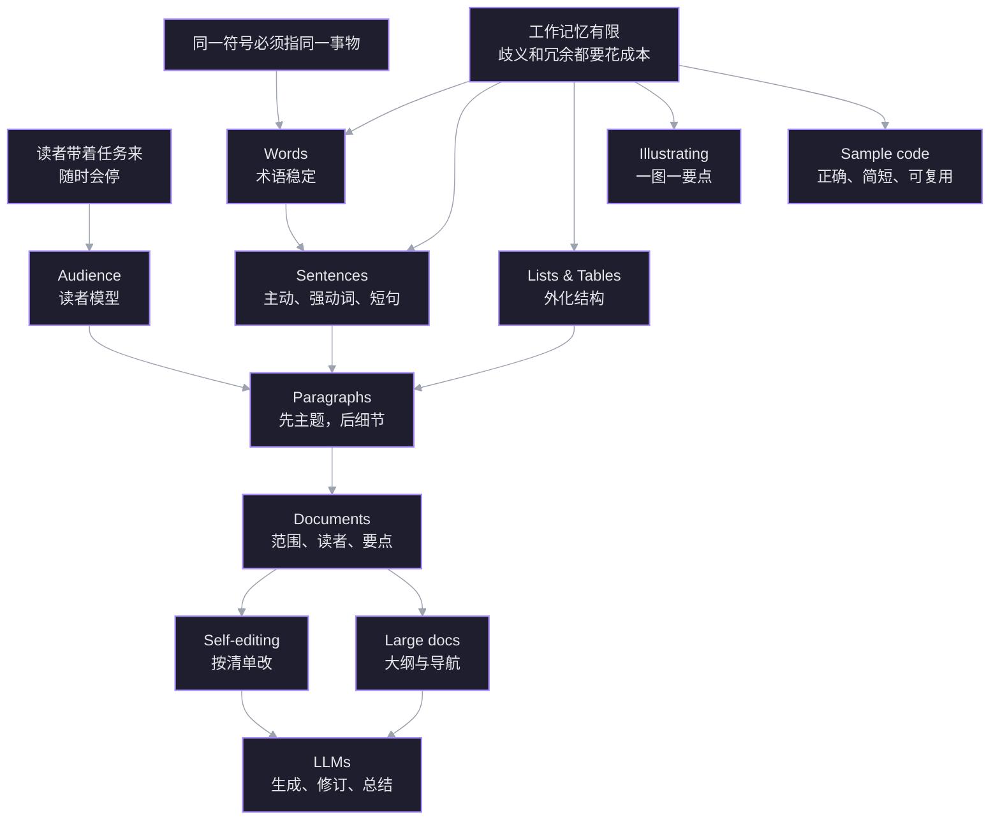

技术写作不是把代码解释得文雅，而是**降低读者完成任务的成本**。Google 这门课把「写清楚」拆成了可以逐项检查的动作：词、句、段、文档、标点、编辑、插图、示例代码，以及如何让 LLM 帮忙而不添乱。

目标不是文采，是让目标读者一次读懂、能照着做。结课时拿一篇自己的真实文档，按检查表改到几乎没有歧义，就算过关。

## 课程地图



根节点只有三条：读者是带着任务来的；读者的工作记忆有限；同一个符号必须始终指同一个东西。上面的词、句、段、文档、插图、代码，都是这三条在不同尺度上的展开。

## 诊断：这次从哪里往上搭

| 线索 | 状态 | 证据 |
|---|---|---|
| 主动/被动语态的识别 | 已稳 | 能正确选出 `The loader reads the configuration file.` |
| 段落主题句 | 已稳 | 能选出 `A loop runs the same block of code multiple times.` 作为「介绍循环」的首句 |
| 读者知识差 | 已稳 | 能正确解释「好文档 = 读者需要的知识 − 读者已有的知识」 |
| 句子层的用词精确度 | **当前缺口** | 在 `The exception occurs...` 与 `Dividing by zero raises the exception.` 之间选了前者 |

所以这次不从「什么是主动语态」讲起。前几天直接练**改写**：把弱动词换成具体动词、把 `there is/are` 拆掉、把长句拆成一句一意。越往后，检查表越长。

## 分日期规划

每天 30–45 分钟。默认按顺序走；某天没完成就顺延，但不要跳过前置单元——后面的检查表会直接用到前面的规则。

| 日期 | 单元 | 当天要回答的问题 | 产出 |
|---|---|---|---|
| 11-08 周日 | 诊断 + **Words** | 读者会在哪个术语、缩写或代词上卡住？ | 3 处术语/代词改写 |
| 11-09 周一 | **Active voice** | 谁对谁做了什么？句子有没有说清？ | 8 句判断 + 4 句改写 |
| 11-10 周二 | **Clear sentences** | 动词够不够具体？有没有 `there is/are` 撑着？ | 6 句强动词改写 |
| 11-11 周三 | **Short sentences** | 一句话是不是塞了好几个想法？ | 3 个长句拆写 + 1 个列表化 |
| 11-12 周四 | **Lists and tables** | 该编号还是项目符号？条目平行吗？ | 1 组平行列表 + 1 张表 + 引导句 |
| 11-13 周五 | **Paragraphs** | 首句有没有给出这一段的主旨？ | 1 段主题句重写 + 删 2 句跑题句 |
| 11-14 周六 | **Audience** | 读者是谁、已经知道什么、还缺什么？ | 1 页读者画像 + 需求清单 |
| 11-15 周日 | **Documents** + TW1 复盘 | 范围、非范围、读者、要点写了吗？ | 1 个文档开头 |
| 11-16 周一 | **Punctuation** + **Markdown** | 停顿和并列关系清楚吗？结构能纯文本表达吗？ | 1 段标点修正 + Markdown 速查 |
| 11-17 周二 | **Self-editing** | 初稿之后按什么清单改？ | 1 张自编辑检查表 |
| 11-18 周三 | **Organizing large docs** | 一篇还是多篇？怎么导航？怎么渐进披露？ | 1 份大纲 + 导航 |
| 11-19 周四 | **Illustrating** | 读者看完图该记住哪一句话？ | 3 条 caption + 1 张图的选择 |
| 11-20 周五 | **Creating sample code** | 示例可运行、可理解、可复用吗？ | 1 组好例/反例 + 注释 |
| 11-21 周六 | **Using LLMs** | prompt 有没有角色、读者、类型、目标、约束？ | 1 个可复用 prompt 模板 |
| 11-22 周日 | TW2 复盘 + 综合改写 | 整份文档能不能按检查表过一遍？ | 1 篇真实文档改写 |
| 11-23 周一 | 结课复盘 | 哪些规则已经变成习惯，哪些还要看表？ | 个人检查表定稿 |

> 可选加餐：`Writing Helpful Error Messages`（约 1.5 小时）和 `Tech Writing for Accessibility`（约 1.5 小时）。等 One + Two 走完，再决定要不要各花两天。

## 每天怎么学

1. **读原文**（5 分钟）：只读当天单元，对照 [[Writing/Ref/Google Technical Writing · 课程原文|课程原文]] 里对应的标题。
2. **听讲解**（10 分钟）：把规则接回三条根节点，不背定义。
3. **做改写**（10–15 分钟）：用当天单元的原则改 3–6 个真实句子；改完对照原文例子。
4. **小测**（5 分钟）：一道有正确答案的题；答错立刻写进 `Writing/Errors.md`，答对也写一句为什么。
5. **落一句速查**（2 分钟）：把当天规则压成一句能放进检查表的话。

题目和答案会直接写进下面的「学习记录」，不在会话结束后补。

## 学习记录

### 2026-11-08 · 诊断

- 已稳：主动/被动识别、段落主题句、读者知识差。
- 缺口：句子层的用词精确度——能在语法上选出主动句，但还不会在几个都「没错」的句子里挑最有信息量的那个。
- 对应策略：Words 之后直接把 Active voice 当改写练，不当识别课；Clear sentences 和 Short sentences 各多留一天。

### 2026-11-08 · Words

**为什么先学词**：句子是词的序列；术语和代词是读者脑内的符号表。符号表不稳定，后面每个句子都要重新解析。读者不会报错，只会停下来、猜、然后放弃。

#### 节点 1 · 术语：一个东西只有一个名字

**定义新术语**：读者可能不认识的词，二选一：

- 已有好解释：链接过去，不要重写。
- 本文首次引入：当场定义；术语多就收进 glossary。

**保持一致**：同一份文档里，一个东西只用一个名字。中途把 **Protocol Buffers** 改成 **protobufs**，读者的「链接器」会找不到符号。要缩短，就在首次出现时显式约定：

> **Protocol Buffers**（简称 **protobufs**）……

之后一直用约定好的那个。

**缩写**：首次出现写全称，括号里给缩写，两者都加粗；之后只用缩写，不要来回切换。

> 本文面向第一次接触 **Telekinetic Tactile Network**（**TTN**）的工程师……

只在「缩写显著更短，且全文出现很多次」时定义；只出现两三次的缩写，直接写全称。

**连接**：这挂在根节点「同一符号必须指同一事物」上。读者看到两个近义词，会默认作者在暗示细微区别，于是停下来找区别——这就是成本。

> [!question] 小测 · 缩写首次出现
> 这段文字首次出现 MapReduce，且 MR 是最佳缩写。下面哪个改法最符合课程规范？
> - A. Jeff Dean invented MR (MapReduce) in 1693. This version of MR held several world records.
> - B. Jeff Dean invented MapReduce (MR) in 1693. This version of MR held several world records.
> - C. Jeff Dean invented MapReduce in 1693. This version of MR held several world records.

> [!success] ✓ 正确
> 选 B。首次出现写全称，括号里给缩写；之后统一用缩写，不再切回全称。A 把顺序反了，读者先看到 MR 再看到全称，多一次反向解析；C 在没定义 MR 的情况下直接用了缩写。

#### 节点 2 · 代词：读者脑内的指针必须唯一可达

代词像指针：它不携带内容，只指向前面出现过的名词。指针必须能唯一解析，否则读者会在脑内触发「空指针」。

三条规则：

- 先名词，后代词；不要反过来。
- 代词尽量靠近所指名词；中间超过 5 个词，考虑重复名词。
- 名词和代词之间又插了另一个名词，直接重复名词，不要用代词。

`it` / `they` / `their` 最容易出事；`this` / `that` 也是。修法只有两种：重复名词，或让 `this` / `that` 后面紧跟一个名词。

例子：

> Python is interpreted, while C++ is compiled. **It** has an almost cult-like following.

`It` 指 Python 还是 C++？读者得停下来猜。改成 `Python has...`。

> Running the process configures permissions and generates a user ID. **This** lets users authenticate to the app.

`This` 指运行过程、user ID，还是整件事？改成 `This user ID lets users authenticate.`，或 `The process of configuring permissions lets users authenticate.`

**连接**：术语稳定解决「这个词指什么」，代词解决「这一次指的是哪个词」。两者都在维护读者的符号表；省掉一个词，可能换来一次解析失败，不划算。

> [!question] 小测 · 代词指代
> 下面哪一句的代词指代不唯一？
> - A. Maya wrote the parser. She tested it against the sample input.
> - B. Python is interpreted, while C++ is compiled. It has an almost cult-like following.
> - C. Sam fixed the bug. He added a regression test.

> [!success] ✓ 正确
> 选 B。`It` 与 Python、C++ 两个候选名词等距，语法上都能解析，读者只能靠语义猜。A 里 `She` 只可能是 Maya，`it` 只可能是 parser；C 里 `He` 只可能是 Sam。

> [!question] 改写练习
> 用今天的规则改下面三句；每句只改到「读者不需要猜」为止。
> 1. Protocol Buffers provide their own definition language. And that's why protobufs have won so many county fairs.
> 2. Running the process configures permissions and generates a user ID. This lets users authenticate to the app.
> 3. Be careful when using Frambus or Carambola with HoobyScooby or BoiseFram because a bug in their core may cause accidental mass unfriending.

> [!success] ✓ 第 1 句 · 方向正确
> 你已经建立了 `Protocol Buffers → protobufs` 的映射，后面也统一用了 `protobufs`，主要问题解决了。再收紧一步：写成 `Protocol Buffers (or protobufs for short)`，并补一个空格。括号里只有 `protobufs` 时，读者仍可能犹豫这是简称、别名还是另一个东西；`for short` 把约定说死。

> [!failure] ✗ 第 2 句 · 换成了一个没有指代对象的模糊名词
> `All these methods` 在前一句里找不到先行词——前一句只有「运行过程」「权限」「user ID」，没有 methods。你把一个歧义代词换成了另一个歧义名词，读者仍然要猜。
> 正确做法是点名真正的指代对象：
> - 如果起作用的是 user ID：`This user ID lets users authenticate to the app.`
> - 如果起作用的是整个流程：`Running the process lets users authenticate to the app.`
> 规则不是「禁止代词」，而是「指针必须能唯一解析」。如果你想把两个动作都算进去，`These two operations` 也比 `methods` 清楚，但最好还是点名 user ID 或整个流程。

> [!failure] ✗ 第 3 句 · 把决定指代的责任推给了读者
> 你抓对了问题：`their` 指谁不清楚。但括号里的 `(explicitly quote what the core exactly are)` 是写给作者自己的备注，不是给读者的改写。文档不能要求读者替你决定指代；作者必须选一个：
> - 如果 bug 在 Frambus 的 core：`because a bug in the core of Frambus may cause...`
> - 如果四者都可能有：`because bugs in the cores of these products may cause...`
> 另外，`core` 本身如果是读者不熟悉的术语，应该单独定义或进 glossary；这和代词指代是两个问题。语法上写 `what the core exactly is`（单数）或 `what the cores exactly are`（复数），`explicitly` 拼写。

### 模板

```markdown
### 日期 · 单元

**规则**：一句话。

**例子**：

> 改前
> 改后

> [!question] 小测
> 题目zan

> [!success] ✓ 正确
> 为什么对。

> [!failure] ✗ 不对
> 正确选项 + 为什么；你选的选项对应哪个误解。
```

## 结课标准

- 拿一篇自己的 README、设计文档或技术笔记，按检查表从头改一遍。
- 能向别人指出至少 5 类问题：术语不一致、代词歧义、被动/弱动词、长句多意、列表不平行。
- 能给出一份「读图先读 caption、读代码先读示例」的判断。

## 术语

| 中文 | English | 一句话 |
|---|---|---|
| 主动语态 | active voice | actor + verb + target，谁做什么一目了然 |
| 被动语态 | passive voice | target + be + past participle (+ by actor)，actor 常被藏起来 |
| 祈使动词 | imperative verb | 命令式动词，如 open、set；编号步骤常用 |
| 平行列表 | parallel list | 所有条目在语法、类别、大小写、标点上一致 |
| 主题句 | lead sentence | 段落第一句，先给这一段的主旨 |
| 知识诅咒 | curse of knowledge | 专家忘了新手不知道什么，解释里跳过关键前提 |
| 渐进披露 | progressive disclosure | 新概念只在读者需要它的地方出现 |
| 反例 | anti-example | 明确展示「不要这样写」，与好例成对出现 |
| 替代文本 | alt text | 图片的功能等价文字，说明用途与上下文 |
